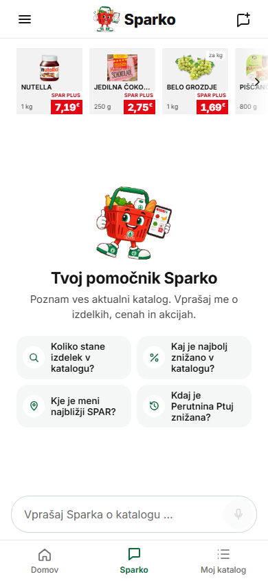
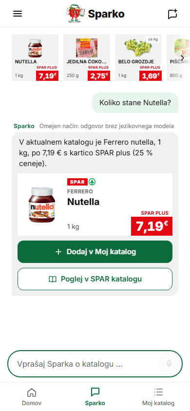
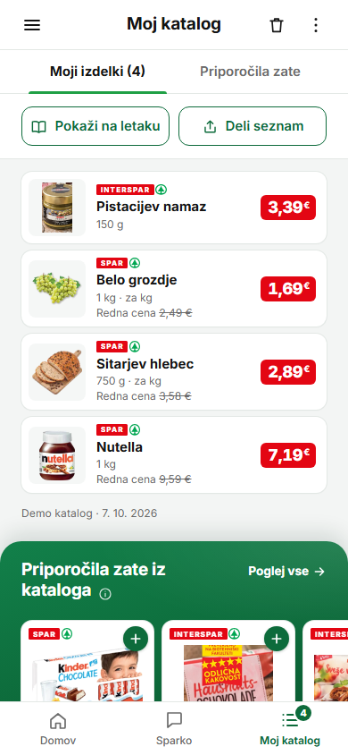
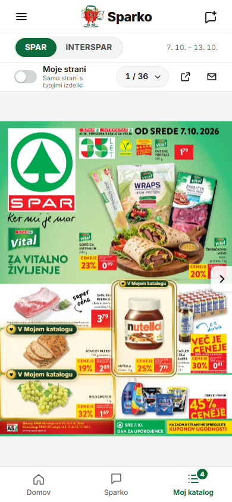

<div align="center">

# SPARko

### AI-powered digital catalog assistant for SPAR

SPARko turns a printed promotional leaflet into an interactive shopping experience.<br>
Ask in plain Slovenian, get verified prices, build your own catalog and jump straight from the conversation to the exact product in the original leaflet.

<br>

<table>
  <tr>
    <td align="center"></td>
    <td align="center"></td>
    <td align="center"></td>
    <td align="center"></td>
  </tr>
  <tr>
    <td align="center"><sub><b>Ask Sparko</b></sub></td>
    <td align="center"><sub><b>Verified product card</b></sub></td>
    <td align="center"><sub><b>Moj katalog</b></sub></td>
    <td align="center"><sub><b>Highlighted in the leaflet</b></sub></td>
  </tr>
</table>

</div>

---

## What is SPARko?

SPARko is a mobile-first **prototype** of a conversational shopping assistant built on top of two real promotional catalogs: **SPAR 41/26** (36 pages) and **INTERSPAR 14/26** (8 pages), with 164 verified products, both valid **7.–13. 10. 2026**.

Instead of flipping through 44 pages of PDFs, shoppers talk to **Sparko**: they ask what something costs, what's discounted, what to cook, or what fits a budget. Every answer is backed by structured catalog data, every product can be saved to a personal **Moj katalog**, and every product links back to its exact spot in the original leaflet.

## Why SPARko is different

This is not a chatbot placed next to a PDF. The assistant, the structured catalog data and the visual leaflet are wired together.

> **Ask:** *"Koliko stane Nutella?"*
>
> **→** Sparko answers with a verified product card: SPAR · Ferrero Nutella, 1 kg, **7,19 €** (SPAR plus), PDF page 1
> **→** One tap saves it to **Moj katalog**
> **→** *"Poglej v SPAR katalogu"* opens the original leaflet (SPAR or INTERSPAR) on the right page, with the product visually highlighted

The language model writes the sentence. It never decides the price.

## Key features

| | |
| --- | --- |
| **Natural Slovenian conversation** | Free-form questions with contextual follow-ups and suggested next questions |
| **Verified catalog pricing** | Prices, package sizes, discounts and validity dates come from the catalog data, not from the model |
| **Two catalogs, one app** | SPAR 41/26 and INTERSPAR 14/26; every product, row and card carries a **SPAR / INTERSPAR** label |
| **Home (Domov)** | Full (uncropped) catalog cover cards, a *Katalogi / Izdelki* toggle (Izdelki opens on **VSI**, then Zajtrk, Pekovsko pecivo, Večerja, Osnovna živila, Mlečni izdelki …), quick actions (*Kaj je najbolj znižano*, *Poglej izdelke po kategoriji* → category sheet, *Kaj je novega v katalogu*, *Kje je najbližji SPAR*). Top list and bottom rail share one state; the middle section never moves |
| **Current vs. upcoming discounts** | *"Kaj je najbolj znižano?"* shows **only currently valid** discounts. Timing questions (*"Kdaj bo izdelek najbolj znižan?"* → *"Za kateri izdelek …?"*, *"Kdaj bo skuta v akciji?"*) show **Znižano ta teden** plus the upcoming week; every simulated future offer is marked **Demo napoved** |
| **Moj katalog** | Compact list of saved products (removal mode behind the trash icon), *Pokaži na letaku*, *Deli seznam* and a green **Priporočila zate** band with explained recommendations |
| **Leaflet navigation** | Jump from any product to its exact location in the original SPAR or INTERSPAR leaflet (`/letak?katalog=…`) |
| **Product highlighting** | 164 verified products are tappable on the leaflet pages (incl. the whole SPAR cover: Svinjska rebra, Radler …); save/remove there too |
| **Recipes & budget ideas** | Verified recipes built from leaflet products and budget-aware shopping suggestions |
| **Typo & morphology tolerance** | Handles Slovenian inflection and misspellings (*skuto*, *skute*, *skta* …) |
| **Persistent state** | Saved products and conversations survive a page reload |
| **Responsive, mobile-first UI** | Designed for phones first, works on desktop |
| **Live AI + limited fallback** | If the model is unavailable, search, product cards, saving, recipes and the leaflet keep working |

## AI + verified catalog data

SPARko separates conversational AI from trusted catalog facts.

- The model (Anthropic Claude, server-side only) interprets the question and writes a short natural-language reply.
- **Prices, package sizes, discounts, dates, totals and catalog pages** are inserted from `src/data/catalog.json`, never generated.
- Model output is validated against a schema; it may only reference product IDs that the deterministic search actually retrieved.
- Responses that try to **invent a price** or **falsely claim a product was saved** are rejected, and SPARko falls back to a clearly labelled *limited mode* answer.
- Saving, removing and navigating are application actions; clicking a product never needs the model.

API keys stay on the server. No AI keys are exposed to the browser.

More detail on the data pipeline: [docs/DATA.md](docs/DATA.md) · full QA log: [planning/QA-REPORT.md](planning/QA-REPORT.md)

## Quality

| Check | Result |
| --- | --- |
| Data validation | ✅ PASS (2 catalogs, 164 products / offers / placements, 44 pages, 3 recipes, 10 mocked future promos) |
| TypeScript typecheck | ✅ PASS |
| Lint | ✅ PASS |
| Unit tests (Vitest) | ✅ 301 / 301 |
| E2E tests (Playwright) | ✅ 115 / 115 |
| Production build | ✅ PASS |
| Browser-exposed AI keys | ✅ 0 |

Responsive layout checked at **360 / 390 / 430 px** and desktop.

## Tech stack

- **Next.js 16** (App Router) · **React 19** · **TypeScript**
- **Anthropic SDK** (Claude) for the conversational layer
- **Zod** for schema validation of catalog data and model output
- **Vitest** (unit) · **Playwright** (E2E) · **ESLint**
- Deployed on **Vercel**

## Run locally

Requires Node.js ≥ 20.9.

```bash
npm ci
npm run dev        # http://localhost:3000
```

Without any environment variables SPARko runs in **limited mode** (deterministic search, product cards, Moj katalog, recipes and the leaflet all work). To enable live AI, copy `.env.example` to `.env.local` and set:

| Variable | Purpose |
| --- | --- |
| `ANTHROPIC_API_KEY` | Server-side key for live AI answers |
| `AI_MODEL` | Optional model override (default `claude-haiku-4-5`) |
| `UPSTASH_REDIS_REST_URL`, `UPSTASH_REDIS_REST_TOKEN` | Persistent rate limiting, required for live AI in production |
| `ALLOW_UNLIMITED_AI` | `true` enables live AI in production without rate limiting (private demos only) |

Other scripts: `npm run build`, `npm run lint`, `npm run typecheck`, `npm test`, `npm run test:e2e`, `npm run validate:data`.

## Demo (mocked) data

Everything printed in the two leaflets is verified catalog data. Two things are **explicitly mocked** for the demo and are labelled as such in the data files:

- **Future promos** (`src/data/future-promos.json`, `"mock": true`): 10 invented promotions for 14.–20. 10. 2026 that feed *Znižano naslednji teden*. They are not from any leaflet; the current price always comes from the verified offer.
- **Demo forecast** (`src/lib/demoForecast.ts`): every verified product can be answered with *"Naslednji teden"*, labelled **Demo napoved**. Without a structured promo above, no future price or percentage is shown.
- **Demo date** (`src/lib/promoCalendar.ts`): when the real date is outside the catalog validity, the demo treats the catalog week (from 7. 10. 2026) as "this week".
- **"Novo" flags**: 2 products carry a printed NOVO badge (`printed_badge`); 6 more are `demo_editorial` picks chosen by the authors and are not claimed by the leaflet.

Details and validator rules: [docs/DATA.md](docs/DATA.md).

## Project status & disclaimer

SPARko is an independent **prototype / showcase implementation**, not an official SPAR product. It uses SPAR Slovenija and INTERSPAR leaflets (SPAR 41/26, INTERSPAR 14/26, 7.–13. 10. 2026) as demo data; prices and dates reflect that leaflet, not current in-store prices. SPAR and related brand names belong to their respective owners.
